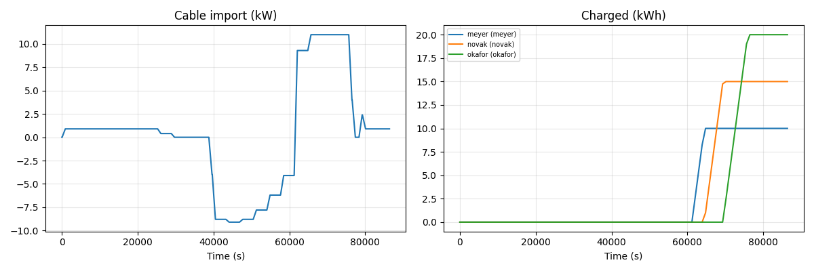
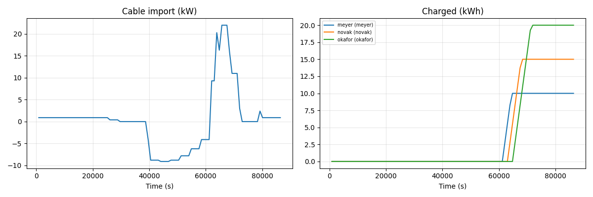

.. _advanced-simulation-tutorial:

=================================================
Tutorial: Can the Solar Street Charge Three Cars?
=================================================

In about 55 minutes you turn the Solar Street from :doc:`the first tutorial
<first-simulation-tutorial>` into a small simulation study. The sky and the
street's cable move into an *environment* that every device senses and acts
on. Three electric cars come home on their own timetables, and a coordinator
asks them every 15 minutes before it shares the cable. The study answers one
question:

    Can the street charge three electric cars every evening without
    overloading its 11 kW cable, and does that still hold under a grey sky and
    with a slow wallbox?

Four hypotheses split the question. Parts 2 to 4 test them one by one, and
each part asks you to guess before you run it:

- **H1:** cars that charge as soon as they are plugged in overload the cable.
- **H2:** a coordinator keeps the cable at 11 kW and still fills every car
  before midnight.
- **H3:** this still works under a grey sky.
- **H4:** it still works when every message to and from one wallbox takes
  45 s.

At the end your script prints one row per simulated day (Part 2 explains the
columns):

.. code-block:: text

    Scenario       Self-suff.  Peak kW  Overload  Round  Late  Cars full at
    no-limit              37%     22.0    90 min    0 s     0  18:00 19:00 20:00
    11kW-limit            37%     11.0     0 min    0 s     0  18:00 19:30 21:15
    grey-sky              18%     14.0    30 min    0 s     0  18:00 19:30 22:00
    slow-wallbox          48%     11.0     0 min   60 s    96  18:00 19:30 never
    longer-timeout        37%     11.0     0 min   90 s     0  18:00 19:30 21:15

Your script also draws each day; this is the day with the 11 kW limit:

          when the full battery lets the street feed in. It is 9.3 kW from
          17:00 and holds at 11 kW from 18:00 to 21:00. The energy charged by
          the three cars rises one after another to 10, 15 and 20 kWh.

    Left: the street's import through its cable. Each point shows the average
    of the last full quarter hour, so the line lags a quarter hour behind: it
    starts at 0 kW until the first reading at 900 s (00:15), and the 11 kW held
    from 18:00 to 21:00 shows from 65,700 s to 75,600 s. Right: the energy each
    car has charged. Time is in seconds since midnight: 64,800 s is 18:00 and
    76,500 s is 21:15.

These ideas are new:

===========================  ====================================  ==============================================  ==========
Idea                         Think of it as                        In this tutorial                                Learned in
===========================  ====================================  ==============================================  ==========
**Environment**              the physical world the devices share  the sky, and the street's cable with its meter  Part 1
**Timestamp task**           an alarm clock                        each car plugs in when its family comes home    Part 2
**Agent recording**          one data logger per device            the energy each car has charged                 Part 2
**Periodic task**            a timetable                           a round every 15 minutes                        Part 3
**Request and reply**        a roll call                           "How much do you need?", asked of every car     Part 3
**Event-by-event stepping**  skipping to the next appointment      the clock jumps from round to round             Part 3
**Network model, timeout**   a slow line and a patience limit      the Okafors' wallbox                            Part 4
===========================  ====================================  ==============================================  ==========

.. testsetup:: *

    import os
    import random
    import tempfile

    import matplotlib

    matplotlib.use("Agg")

    _tutorial_cwd = os.getcwd()
    _tutorial_tmp = tempfile.TemporaryDirectory()
    os.chdir(_tutorial_tmp.name)

.. code-block:: bash

    pip install --upgrade mango-agents matplotlib

Write the code into a new file ``street_study.py``. Parts 1 to 4 each tell you
what to add or replace. After each part, run ``python street_study.py`` and
compare the output with this page. If something does not work, see
:ref:`advanced-simulation-troubleshooting`.

.. _advanced-simulation-environment:

Part 1: The street becomes an environment
=========================================

In the first tutorial each house looked up the sun on its own and reported its
power in a message. But one sky shines on every roof, and the street's cable
carries the *sum* of all houses. Nobody owns the sky or decides what flows
through a cable: such shared physics belongs in the **environment**, one
object per world that every agent senses and acts on. This rule of thumb
guides the whole tutorial:

==============================================  =================  ==================================
Question                                        Put it in          Here
==============================================  =================  ==================================
Shared by all, decided by no one?               the environment    the sky, the cable and its meter
Owned and decided by someone?                   an agent           houses, battery, cars, coordinator
Known to one agent, needed by another?          a message          a car's need, a setpoint (Part 3)
How fast and how reliably do messages travel?   the network model  a slow wallbox (Part 4)
==============================================  =================  ==================================

So the ``Grid`` agent becomes the street's meter, since it only counted and
never decided. The ``PowerReport`` messages are gone: every device adds the
energy it takes from the cable to the street's ``drawn_kwh``. The cable may
carry at most 11 kW, the street's share of the local transformer. For three
houses that is realistic: a real street cable carries 100 kW or more for 30
to 60 houses, about 2 to 4 kW per house. Three 11 kW wallboxes need three
times as much. Put the next four blocks into ``street_study.py``.

.. testcode::

    import asyncio
    from dataclasses import dataclass

    from mango import Agent, DefaultEnvironment, SimpleCommunicationSimulation
    from mango import on_message, periodic, run_with_simulation
    from mango import plot_recordings, record_agent, record_world

    SUN = [
        0.00, 0.00, 0.00, 0.00, 0.00, 0.00,
        0.00, 0.26, 0.50, 0.71, 0.87, 0.97,
        1.00, 0.97, 0.87, 0.71, 0.50, 0.26,
        0.00, 0.00, 0.00, 0.00, 0.00, 0.00,
    ]
    LOAD_KW = [
        0.3, 0.3, 0.3, 0.3, 0.3, 0.3,
        0.3, 1.0, 1.0, 0.3, 0.3, 0.3,
        0.3, 0.3, 0.3, 0.3, 0.3, 0.3,
        1.3, 1.3, 1.3, 1.3, 0.3, 0.3,
    ]
    CABLE_LIMIT_KW = 11.0
    WALLBOX_KW = 11.0

As in the first tutorial, the ``import`` lines load everything this tutorial
needs, including what you first use in Parts 2 to 4. ``SUN`` and
``LOAD_KW`` are unchanged. ``CABLE_LIMIT_KW`` is the cable's 11 kW;
``WALLBOX_KW`` is for the cars in Part 2.

.. testcode::

    class Street(DefaultEnvironment):
        def __init__(self, sky):
            super().__init__()
            self.sky = sky
            self.drawn_kwh = 0.0
            self.bought_kwh = 0.0
            self.meter_kwh = 0.0
            self.meter_s = 0.0
            self.cable_kw = 0.0
            self.peak_kw = 0.0
            self.overload_s = 0.0

        def sun(self, time):
            return SUN[int(time / 3600) % 24] * self.sky

        def step(self, clock, step_size_s):
            super().step(clock, step_size_s)
            self.bought_kwh += max(self.drawn_kwh, 0.0)
            self.meter_kwh += self.drawn_kwh
            self.meter_s += step_size_s
            self.drawn_kwh = 0.0
            if self.meter_s >= 900:
                self.cable_kw = self.meter_kwh * 3600 / self.meter_s
                self.peak_kw = max(self.peak_kw, self.cable_kw)
                if self.cable_kw > CABLE_LIMIT_KW + 0.01:
                    self.overload_s += self.meter_s
                self.meter_kwh = 0.0
                self.meter_s = 0.0

- ``class Street(DefaultEnvironment):`` makes a new kind of mango environment
  (:class:`~mango.DefaultEnvironment`), as ``House(Agent)`` made a new kind of
  agent. ``sky`` is the share of the clear-sky sun, 1.0 on a clear day and
  0.2 on a grey one.
- ``sun`` gives every roof the hour's share of peak power: ``return`` hands a
  value back to whoever asks, here ``env.sun(clock.time)`` in ``House``.
- ``drawn_kwh`` collects the energy that all devices take from the cable in a
  step: positive when the street draws power, negative when it feeds in.
- mango calls ``step`` once per step, after the ``on_step`` of every agent
  and before it delivers messages and saves recordings
  (:meth:`~mango.DefaultEnvironment.step`; compare the first tutorial's
  :ref:`three moves <first-simulation-messages>`). Its first line runs
  mango's own part, which matters once you add a :class:`~mango.Behavior`,
  environment logic you plug in without writing your own environment class
  like ``Street``. Then the street books what it bought (``max(..., 0.0)``
  keeps only positive values) and empties ``drawn_kwh``.
- The rest is the street's **meter**. Grid meters record power as 15-minute
  averages, so this one collects energy and seconds until a quarter hour
  (900 s) is full. Then it books three values: ``cable_kw``, the average
  power (kWh × 3,600 ÷ s); ``peak_kw``, the highest average so far; and
  ``overload_s``, the seconds of quarter hours above the limit. The
  ``+ 0.01`` ignores the tiny rounding errors that computers make with
  decimals, such as 11.000000000000002 kW. Peak and overload count imports
  only. Feed-in shows as negative averages, at most 9.1 kW at noon and so
  below the limit; with more PV, check feed-in too.

Environments can also place agents on a map (:class:`~mango.Area2D`) and send
them events; this 50 m street lies under one sky and needs neither
(:ref:`simulation-spatial-environment`).

.. testcode::

    class House(Agent):
        def __init__(self, pv_peak_kw):
            super().__init__()
            self.pv_peak_kw = pv_peak_kw
            self.load_kwh = 0.0

        def on_step(self, env, clock, step_size_s):
            hours = step_size_s / 3600
            load_kw = LOAD_KW[int(clock.time / 3600) % 24]
            pv_kw = self.pv_peak_kw * env.sun(clock.time)
            self.load_kwh += load_kw * hours
            env.drawn_kwh += (load_kw - pv_kw) * hours

    class Battery(Agent):
        def __init__(self, capacity_kwh):
            super().__init__()
            self.capacity_kwh = capacity_kwh
            self.stored_kwh = 0.0

        def on_step(self, env, clock, step_size_s):
            spare_kwh = -env.drawn_kwh
            if spare_kwh > 0:
                charge_kwh = min(spare_kwh, self.capacity_kwh - self.stored_kwh)
            else:
                charge_kwh = max(spare_kwh, -self.stored_kwh)
            self.stored_kwh += charge_kwh
            env.drawn_kwh += charge_kwh

- ``on_step`` now uses ``env``, the world's environment, here the street
  (:meth:`~mango.Agent.on_step`). The house reads the sun from it and adds its
  load minus its PV to ``env.drawn_kwh``.
- ``hours = step_size_s / 3600`` is the step's length in hours, so kW × hours
  is kWh for steps shorter than an hour too; :ref:`the first tutorial
  <first-simulation-house>` needed one-hour steps for that. ``SUN`` and
  ``LOAD_KW`` change on the hour, so no step may cross a full hour: 900 s
  works, 2,700 s does not.
- ``Battery`` keeps the min/max logic of :ref:`the first tutorial's battery
  <first-simulation-battery>`, still without losses or a power limit, in kWh
  per step: it charges what the street would feed in, ``-env.drawn_kwh``,
  and discharges what it would draw. Listed after the houses, it finds exactly
  their sum in ``env.drawn_kwh``.

.. testcode::

    async def main(sky):
        street = Street(sky=sky)
        houses = [House(pv_peak_kw=4.0), House(pv_peak_kw=0.0), House(pv_peak_kw=6.0)]
        battery = Battery(capacity_kwh=15.0)
        async with run_with_simulation(*houses, battery, environment=street) as world:
            for quarter in range(96):
                await world.step(step_size_s=900)
        used_kwh = sum(house.load_kwh for house in houses)
        print(
            f"Sky {sky:.0%}: bought {street.bought_kwh:.1f} kWh,",
            f"self-sufficiency {1 - street.bought_kwh / used_kwh:.0%},",
            f"peak import {street.peak_kw:.1f} kW",
        )

    asyncio.run(main(sky=1.0))
    asyncio.run(main(sky=0.2))

- ``Street(sky=sky)`` hands ``main``'s ``sky`` on to the street: left of
  ``=`` is the street's setting, right of it the value.
- ``houses`` is a list of the Meyers', the Novaks' and the Okafors' houses.
  ``*houses`` lists them one by one, as if you had written each, and
  ``sum(house.load_kwh for house in houses)`` adds up one value per house.
- ``environment=street`` puts the street into the world
  (:func:`~mango.run_with_simulation`), and mango hands it to every
  ``on_step`` as ``env``.
- The day now has 96 steps of 900 s, a quarter hour each
  (:ref:`simulation-fixed-step`).

Save and run the script. You should see:

.. testoutput::

    Sky 100%: bought 9.1 kWh, self-sufficiency 76%, peak import 2.4 kW
    Sky 20%: bought 22.6 kWh, self-sufficiency 40%, peak import 3.9 kW

Check: the first tutorial's street with the 15 kWh battery bought 9.7 kWh
(74%). The battery now sees the sum of the houses, so the order effect that
tutorial :ref:`warned about <first-simulation-street>` is gone: 9.1 kWh
(76%). The peak, 2.4 kW, falls into the quarter hour from 21:45, when the
battery runs empty. The houses need 3.9 kW × 0.25 h = 0.975 kWh, the battery
holds only 0.375 kWh, and the street buys the other 0.6 kWh: 2.4 kW on
average. Under the grey sky the peak is the houses' evening load, 3.9 kW.
Either way the houses stay far below 11 kW.

.. _advanced-simulation-cars:

Part 2: Three cars come home
============================

Each family now owns an electric car with an 11 kW wallbox (three-phase,
16 A). In the evening the cars come home and plug in:

- the Meyers' at 17:00, needing 10 kWh (about 60 km at 17 kWh per 100 km);
- the Novaks' at 17:30, needing 15 kWh (about 90 km);
- the Okafors' at 18:00, needing 20 kWh (about 120 km).

Each car charges at full power until it is full. Before you run it, guess: how
high does the cable's import peak? Replace everything from ``async def main``
to the end of the file with the next three blocks.

.. testcode::

    class Car(Agent):
        def __init__(self, arrives_h, need_kwh):
            super().__init__()
            self.arrives_h = arrives_h
            self.need_kwh = need_kwh
            self.charged_kwh = 0.0
            self.plugged_in = False
            self.allowed_kw = 0.0
            self.full_at = None

        def on_ready(self):
            self.schedule_timestamp_task(self.plug_in(), timestamp=self.arrives_h * 3600)

        async def plug_in(self):
            self.plugged_in = True
            self.allowed_kw = WALLBOX_KW

        def on_step(self, env, clock, step_size_s):
            if self.full_at is None:
                missing_kwh = self.need_kwh - self.charged_kwh
                charge_kwh = min(self.allowed_kw * step_size_s / 3600, missing_kwh)
                self.charged_kwh += charge_kwh
                env.drawn_kwh += charge_kwh
                if self.need_kwh - self.charged_kwh < 0.01:
                    self.full_at = clock.time + step_size_s

- mango calls ``on_ready`` once, when the world starts
  (:meth:`~mango.Agent.on_ready`, :ref:`agents-container-lifecycle`). There
  the car sets an alarm clock, a **timestamp task**: mango runs ``plug_in``
  when the world's clock reaches ``arrives_h`` × 3,600 s, 61,200 s for the
  Meyers (:meth:`~mango.Agent.schedule_timestamp_task`; other kinds of tasks:
  :ref:`scheduling-task-types`). This happens in ``on_ready``, not in
  ``__init__``, because an agent can set tasks only once it is in a world.
  ``self.plug_in()`` with brackets prepares the job; mango runs it at that
  time.
- ``on_step`` stays ``def``, as the "Copy as is" note in :ref:`the first
  tutorial <first-simulation-house>` says, but a job that mango runs later,
  such as ``plug_in``, is ``async def``.
- With fixed steps, a task that is due between two step ends runs at the end
  of that step. All arrivals here fall on a quarter hour, so they are exact.
- In ``on_step`` the car charges what ``allowed_kw`` allows in the step, but
  no more than it misses, and adds that to ``env.drawn_kwh``. ``full_at`` is
  the end of the step in which the car became full; ``None`` means "not yet",
  and ``is None`` checks for it. ``< 0.01`` is the meter's rounding margin
  again, in kWh. ``plugged_in`` is for Part 3's cars.

.. testcode::

    TABLE_HEADER = "Scenario       Self-suff.  Peak kW  Overload  Round  Late  Cars full at"

    def clock_time(seconds):
        if seconds is None:
            return "never"
        return f"{int(seconds / 3600):02}:{int(seconds / 60) % 60:02}"

    def show_result(label, street, houses, cars, round_s=0.0, late_answers=0):
        used_kwh = sum(house.load_kwh for house in houses)
        used_kwh += sum(car.charged_kwh for car in cars)
        self_sufficiency = 1 - street.bought_kwh / used_kwh
        full_at = " ".join(clock_time(car.full_at) for car in cars)
        print(
            f"{label:<14}{self_sufficiency:>11.0%}{street.peak_kw:>9.1f}",
            f"{street.overload_s / 60:>5.0f} min{round_s:>5.0f} s{late_answers:>6} ",
            full_at,
        )

    def record_day(world, street):
        record_world(world, "Cable import (kW)", lambda: street.cable_kw)
        record_agent(
            world, "Charged (kWh)", lambda car: car.charged_kwh,
            filter_fn=lambda agent: isinstance(agent, Car),
        )

- ``clock_time`` turns seconds into a time of day such as ``21:15``, or
  ``never`` for ``None``.
- ``show_result`` prints one row with these columns:

  - **Self-suff.**: 1 - bought ÷ used, where used now includes the energy
    charged into the cars;
  - **Peak kW**: the highest quarter-hour average import through the cable;
  - **Overload**: the minutes of quarter hours above 11 kW;
  - **Round** and **Late**: the longest round of questions, in seconds, and
    the number of answers that came too late; Part 3 starts measuring them,
    and they first move in Part 4;
  - **Cars full at**: the Meyers', the Novaks' and the Okafors' car;
    ``never`` means not before midnight.

- ``round_s=0.0`` and ``late_answers=0`` are *default values*, used when a
  call leaves them out. ``:<14`` writes a value left-aligned in 14
  characters and ``:>11`` right-aligned in 11, so the columns line up, and
  ``" ".join(...)`` joins the times with spaces.
- To see how hard the cable works and when each car charges, ``record_day``
  adds two recordings: :func:`~mango.record_world` as in
  :ref:`the first tutorial <first-simulation-street>`, and
  :func:`~mango.record_agent`, which records one value per agent
  (:ref:`simulation-recording`).
  ``lambda car: car.charged_kwh`` is a one-line recipe that gets an agent and
  returns its value; ``filter_fn`` picks the agents made from the ``Car``
  class (``isinstance``).

.. testcode::

    async def run(label):
        street = Street(sky=1.0)
        houses = [House(pv_peak_kw=4.0), House(pv_peak_kw=0.0), House(pv_peak_kw=6.0)]
        battery = Battery(capacity_kwh=15.0)
        meyer = Car(arrives_h=17.0, need_kwh=10.0)
        novak = Car(arrives_h=17.5, need_kwh=15.0)
        okafor = Car(arrives_h=18.0, need_kwh=20.0)
        async with run_with_simulation(
            *houses, battery, (meyer, {"aid": "meyer"}), (novak, {"aid": "novak"}),
            (okafor, {"aid": "okafor"}), environment=street,
        ) as world:
            record_day(world, street)
            for quarter in range(96):
                await world.step(step_size_s=900)
        plot_recordings(world, write_to=f"street-{label}.png")
        show_result(label, street, houses, [meyer, novak, okafor])

    print(TABLE_HEADER)
    asyncio.run(run("on-arrival"))

- ``run(label)`` takes the place of ``main``: it runs one day, a *scenario*,
  and prints its row under the name ``label``.
- ``(meyer, {"aid": "meyer"})`` pairs the agent with its settings and gives
  it the address name ``meyer`` (:attr:`~mango.Agent.aid`) instead of a number
  such as ``agent4``. The ``{...}`` is a *dictionary*: it maps a key, here
  ``"aid"``, to a value. The plot's legend shows name and address,
  ``meyer (meyer)``, and Part 4's network model refers to the agents by these
  names.
- The battery is listed before the cars, so it sees only the houses, as if
  its controller measured only the houses' circuit and the wallboxes had
  their own. It stays the houses' battery and keeps its energy for their
  evening load. Listed after the cars, it would empty into them by 18:15.
- Each run writes its picture, here ``street-on-arrival.png``
  (:ref:`simulation-visualization`).

Save and run the script. You should see:

.. testoutput::

    Scenario       Self-suff.  Peak kW  Overload  Round  Late  Cars full at
    on-arrival            37%     22.0    90 min    0 s     0  18:00 19:00 20:00

          22 kW from 18:00 to 18:45, 16 kW until 19:00, 11 kW until 19:45,
          3 kW until 20:00, zero until 21:45, then 2.4 kW and 0.9 kW at
          night. The three cars' charged energy rises steeply, one after
          another.

    ``street-on-arrival.png``: each cable point shows the average of the last
    full quarter hour. 61,200 s is 17:00 and 64,800 s is 18:00.

Check: the peak, 22 kW, is two wallboxes at once, the Novaks' and the
Okafors', from 18:00 to 18:45, while the battery covers the houses. The six
quarter hours from 17:30 to 19:00 lie above 11 kW: 90 min. The Meyers' car
needs 10 kWh ÷ 11 kW = 55 min, so it is full in the quarter hour that ends at
18:00. It charges only 7 kW on average there, which causes the dip to
16.3 kW. The street buys 9.1 kWh for the houses, as in Part 1, plus 45 kWh for
the cars, minus 1.7 kWh of late sun that the cars use before 18:00:
52.4 kWh. Houses and cars use 37.8 + 45 = 82.8 kWh, so self-sufficiency is
1 - 52.4 ÷ 82.8 = 37%. H1: yes, for an hour and a half.

.. tip::

    **Try it yourself.** In ``run``, change ``range(96)`` to ``range(24)`` and
    ``step_size_s=900`` to ``step_size_s=3600``. Expect ``120 min`` overload
    and the Novaks' car full at ``20:00``: their 17:30 plug-in waits for the
    step that ends at 18:00, and the meter sees only hourly averages. Choose
    steps short enough for what you study, then change both back.

.. _advanced-simulation-coordinator:

Part 3: A coordinator shares the cable
======================================

The cars stay parked until morning, so they could wait. But only each car
knows how much it still needs, and that changes every quarter hour. So a new
agent, the **coordinator**, asks every car before it shares the cable. Then
it sends each car a *setpoint*: the power it may charge at until the next
round.

.. code-block:: text

    every 15 min   coordinator --HowMuch-->   meyer, novak, okafor   (gather)
                   coordinator <--Need(kw)--  each car               (reply_to)
                   coordinator --Setpoint-->  each car               (0 kW if no answer)

It shares what the limit leaves after the houses in a fixed order, its own
list: Meyer, Novak, Okafor. The first car gets what it needs, the next what is
left, and so on. Before you run it, guess: how much later is the last car
full? Replace everything from ``async def run`` to the end of the file with
the next four blocks.

.. testcode::

    @dataclass
    class HowMuch:
        pass

    @dataclass
    class Need:
        kw: float

    @dataclass
    class Setpoint:
        kw: float

These are the three messages. ``HowMuch`` carries no value, so its body is
``pass``, Python's word for "nothing here".

.. testcode::

    class SmartCar(Car):
        async def plug_in(self):
            self.plugged_in = True

        @on_message(HowMuch)
        async def answer(self, question, meta):
            kw = 0.0
            if self.plugged_in and self.full_at is None:
                kw = min(WALLBOX_KW, (self.need_kwh - self.charged_kwh) / 0.25)
            await self.reply_to(Need(kw=kw), meta)

        @on_message(Setpoint)
        def follow(self, setpoint, meta):
            self.allowed_kw = setpoint.kw

- ``class SmartCar(Car):`` makes a new kind of ``Car``: it does everything a
  car does, and a method with the same name replaces the car's. Its
  ``plug_in`` does not set ``allowed_kw``, so the car waits for its first
  setpoint. A ``SmartCar`` is still a ``Car``, so ``record_day``'s filter
  keeps finding it.
- ``answer`` asks for what the car still misses, spread over the next quarter
  hour (kWh ÷ 0.25 h) and at most 11 kW, or for 0 kW if the car is not
  plugged in or already full. 0.25 h is the time between two rounds: change
  it together with the coordinator's ``@periodic(900)`` below.
- :meth:`~mango.Agent.reply_to` sends the answer back to whoever asked,
  marked as the answer to that question (:ref:`message-exchange-reply-to`).
  ``meta``, the delivery details from the first tutorial, tells it who asked.
  ``await`` lets ``answer`` wait until mango has sent the answer; meanwhile
  mango may run other agents. Sending takes no simulated time; a network
  delay (Part 4) applies on the way. A method that uses ``await`` must be
  ``async def``. The first tutorial's ``schedule_instant_message`` did not
  wait, so ``on_step`` could stay ``def``.
- ``follow`` sets the power that the coordinator allows, as an average over
  the quarter hour: a real wallbox charges at no less than about 4.1 kW (6 A
  on three phases), so it would reach 1 kW by charging part of the time.

.. note::

    **Inheritance or roles?** ``SmartCar(Car)`` is a car that can also talk.
    If an unrelated device, such as a heat pump, should answer ``HowMuch``
    too, do not copy ``answer`` into it. Write the answering once as a
    :class:`~mango.Role` and add it to both agents with
    :func:`~mango.agent_composed_of`, as the roles note in :ref:`the first
    tutorial <first-simulation-battery>` sketches (:doc:`the roles guide
    <role-api>`).

.. testcode::

    class Coordinator(Agent):
        def __init__(self, street, cars, limit_kw, timeout_s):
            super().__init__()
            self.street = street
            self.cars = cars
            self.limit_kw = limit_kw
            self.timeout_s = timeout_s
            self.given_kw = 0.0
            self.round_s = 0.0
            self.late_answers = 0

        @periodic(900)
        async def every_quarter_hour(self):
            self.schedule_instant_task(self.share_cable())

        async def share_cable(self):
            start = self.current_timestamp
            addresses = [car.addr for car in self.cars]
            needs = await self.gather(
                HowMuch(), addresses, reply_type=Need, timeout=self.timeout_s
            )
            self.round_s = max(self.round_s, self.current_timestamp - start)
            houses_kw = max(self.street.cable_kw - self.given_kw, 0.0)
            room_kw = max(self.limit_kw - houses_kw, 0.0)
            self.given_kw = 0.0
            for addr in addresses:
                need = needs.get(addr, Need(kw=0.0))
                kw = min(need.kw, room_kw - self.given_kw)
                self.given_kw += kw
                await self.send_message(Setpoint(kw=kw), addr)

        @on_message(Need)
        def late_answer(self, need, meta):
            self.late_answers += 1

- ``@periodic(900)`` makes ``every_quarter_hour`` a **periodic task**, a
  timetable: mango runs it at 00:00 and then every 900 s of the world's clock
  (:func:`~mango.periodic`; the roles guide's :ref:`periodic tasks
  <role-periodic>` section shows it in a role, and it works the same in an
  agent). A periodic task counts its 900 s from the end of each run, so a
  round it waited for would push every later round back. That is why it only
  starts the round as a job of its own and does not wait for it
  (:meth:`~mango.Agent.schedule_instant_task`).
- In ``share_cable``, ``[car.addr for car in self.cars]`` makes a list from
  another list: the cars' addresses. The coordinator gets the cars only to
  look up these addresses, which mango assigns when the world starts; it
  never reads their charge directly, because a real coordinator could not.
- :meth:`~mango.Agent.gather` sends ``HowMuch()`` to each address and waits
  until all have answered or ``timeout`` seconds of simulated time have
  passed (:ref:`transactions-gather`). The timeout keeps a car that never
  answers, say because its wallbox is offline, from holding up the round
  forever; Part 4 shows why its length matters. ``gather`` returns a
  dictionary that maps each address to its answer, which can be incomplete;
  ``reply_type=Need`` ignores other kinds of answers. While the coordinator
  waits, the world goes on: the houses keep stepping, and each car keeps
  charging at its last setpoint.
- :attr:`~mango.Agent.current_timestamp` is the time on the world's clock;
  ``round_s`` keeps the longest round.
- mango hands an agent the environment only in ``on_step``, so the
  coordinator keeps the street it was given. ``houses_kw`` estimates what the
  houses still draw from the cable once the battery has helped: the meter's
  last quarter-hour average minus what the cars were allowed in the last
  round, ``given_kw``. It is never below 0 kW, so the coordinator never
  counts on the sun. ``room_kw`` is what the limit leaves for the cars.
- ``needs.get(addr, Need(kw=0.0))`` is the car's answer, or 0 kW if it did
  not answer in time: for the cable, silence means 0 kW. Each car gets what it
  needs while room is left, sent with :meth:`~mango.Agent.send_message`
  (:ref:`message-exchange-sending`).
- Answers that arrive in time go to ``gather``. Answers that miss their round
  arrive as normal messages, and ``late_answer`` counts them. Keep it: the
  coordinator has no other message handler, so without it a late answer stops
  the coordinator's mailbox and freezes the run (:ref:`agent-handlers`). An
  agent with other handlers would drop such answers silently.

The rule for ``async`` is now: ``on_step``, ``on_ready`` and handlers that do
not wait stay ``def``; jobs that mango runs later (timestamp, periodic and
instant tasks) and every method that uses ``await`` are ``async def``. Inside
them, ``await`` goes in front of mango calls that send or wait
(``send_message``, ``reply_to``, ``gather``), never in front of the
``schedule_...`` calls, which only set up a job.

.. testcode::

    async def run(label, sky=1.0, limit_kw=CABLE_LIMIT_KW, timeout_s=60.0, network=None):
        street = Street(sky=sky)
        houses = [House(pv_peak_kw=4.0), House(pv_peak_kw=0.0), House(pv_peak_kw=6.0)]
        battery = Battery(capacity_kwh=15.0)
        meyer = SmartCar(arrives_h=17.0, need_kwh=10.0)
        novak = SmartCar(arrives_h=17.5, need_kwh=15.0)
        okafor = SmartCar(arrives_h=18.0, need_kwh=20.0)
        cars = [meyer, novak, okafor]
        coordinator = Coordinator(street, cars, limit_kw=limit_kw, timeout_s=timeout_s)
        async with run_with_simulation(
            *houses, battery, (meyer, {"aid": "meyer"}), (novak, {"aid": "novak"}),
            (okafor, {"aid": "okafor"}), (coordinator, {"aid": "coordinator"}),
            environment=street, communication_sim=network,
        ) as world:
            record_day(world, street)
            await world.step_until(max_advance_time_s=24 * 3600)
        plot_recordings(world, write_to=f"street-{label}.png")
        show_result(
            label, street, houses, cars, coordinator.round_s, coordinator.late_answers
        )

    print(TABLE_HEADER)
    asyncio.run(run("no-limit", limit_kw=33.0))
    asyncio.run(run("11kW-limit"))
    asyncio.run(run("grey-sky", sky=0.2))

- ``run`` now takes *knobs* with default values: the ``sky``, the
  coordinator's ``limit_kw`` and ``timeout_s``, and the ``network`` for
  Part 4. ``None`` means mango's default network, on which messages arrive
  instantly. ``limit_kw=33.0`` leaves room for all three wallboxes: no limit.
  ``limit_kw=limit_kw`` hands the knob on to the coordinator, as
  ``sky=sky`` did in Part 1.
- ``await world.step_until(max_advance_time_s=24 * 3600)`` replaces the 96
  steps and stops after one simulated day. The world now jumps from one
  scheduled moment to the next: a round, a plug-in, a message landing, a
  timeout ending (:meth:`~mango.SimulationWorld.step_until`,
  :ref:`simulation-discrete-event`). With fixed steps, a message that takes
  seconds could only arrive at the end of a quarter hour.
- ``on_step`` now runs only at those moments, so make sure something is
  scheduled at least as often as your data changes. Here the rounds stop the
  world every quarter hour. ``step_until`` also stops early when nothing is
  left on the timetable; here a round is due at 24:00, so the day ends
  exactly then. Steps differ in length, and the first lasts 0 s, but no step
  crosses a quarter hour and the meter books full quarter hours, so the
  results do not depend on the step lengths.

Save and run the script. You should see:

.. testoutput::

    Scenario       Self-suff.  Peak kW  Overload  Round  Late  Cars full at
    no-limit              37%     22.0    90 min    0 s     0  18:00 19:00 20:00
    11kW-limit            37%     11.0     0 min    0 s     0  18:00 19:30 21:15
    grey-sky              18%     14.0    30 min    0 s     0  18:00 19:30 22:00

Check: the ``no-limit`` row repeats Part 2 exactly: asking and answering change
nothing in the physics. Such a check against a known result is worth doing
whenever you extend a model.

With the 11 kW limit the street buys the same 52.4 kWh at half the peak. The
Meyers notice nothing; the Novaks' car is full 30 min later and the Okafors'
75 min later, at 21:15, while the cars stay parked until morning. The
coordinator never gives the cars more than 11 kW, so their 45 kWh take at
least 4.1 h from 17:00: 21:05 is the earliest possible, and quarter-hour
rounds make it 21:15. H2: yes.

**One step, five moves.** In every step, mango

#. calls ``on_step`` of every agent in the order you listed them, with the
   clock at the start of the step;
#. calls the street's ``step``, which books the cable and, after a full
   quarter hour, the meter;
#. moves the clock to the end of the step and wakes the tasks due by then:
   plug-ins, rounds, timeouts;
#. delivers the messages due by then, including those that tasks and handlers
   send;
#. saves the recordings, stamped with the end of the step.

So each round reads the meter for the quarter hour before it. Under the grey
sky the battery runs empty in the quarter hour from 19:15. Each row below is
a quarter hour and the round at its end:

==============  ===========  ====================  =================
Quarter hour    Meter reads  Houses after battery  Cars allowed next
==============  ===========  ====================  =================
19:00 to 19:15  11.0 kW      0.0 kW                11.0 kW
19:15 to 19:30  11.9 kW      0.9 kW                10.1 kW
19:30 to 19:45  14.0 kW      3.9 kW                7.1 kW
==============  ===========  ====================  =================

The rounds always react to the quarter hour before, so the cable runs above
11 kW for 30 min. A coordinator that ignored the meter, with
``room_kw = self.limit_kw``, would overload it for 105 min at up to 14.9 kW.
From 19:45 the houses take 3.9 kW of the 11 kW, so the Okafors' car charges
at 7.1 kW and is full at 22:00 instead of 21:15, still before midnight.
H3: partly.

The street could warn the coordinator with an :ref:`environment event
<simulation-spatial-environment>`
(:meth:`~mango.DefaultEnvironment.emit_global_event`), but only at the end of
the overloaded quarter hour, exactly when the next round starts anyway.
Events pay off when agents must react between their own timetables.

.. _advanced-simulation-delay:

Part 4: A slow wallbox
======================

The Okafors' wallbox is controlled through its maker's cloud server, which
passes messages on only every 45 s. The model takes the worst case: every
message to or from the wallbox takes 45 s. All other links stay instant.
Before you run it, guess: with the coordinator's 60 s timeout, what happens to
the Okafors' car? Replace the last four lines of the file, from
``print(TABLE_HEADER)`` on, with this block.

.. testcode::

    slow_link = {("coordinator", "okafor"): 45.0, ("okafor", "coordinator"): 45.0}
    slow_network = SimpleCommunicationSimulation(delay_s_directed_edge_dict=slow_link)

    print(TABLE_HEADER)
    asyncio.run(run("no-limit", limit_kw=33.0))
    asyncio.run(run("11kW-limit"))
    asyncio.run(run("grey-sky", sky=0.2))
    asyncio.run(run("slow-wallbox", network=slow_network))
    asyncio.run(run("longer-timeout", timeout_s=120.0, network=slow_network))

- :class:`~mango.SimpleCommunicationSimulation` is mango's network model
  (:ref:`simulation-communication`). ``delay_s_directed_edge_dict`` sets the
  delay in seconds per link. Each key is a pair of address names in round
  brackets, sender first, so each direction needs its own entry; links that
  are not listed stay instant.
- ``run`` passes the network on to ``run_with_simulation``; nothing else
  changes. The last run gives the coordinator more patience: 120 s.

Save and run the script. You should see:

.. testoutput::

    Scenario       Self-suff.  Peak kW  Overload  Round  Late  Cars full at
    no-limit              37%     22.0    90 min    0 s     0  18:00 19:00 20:00
    11kW-limit            37%     11.0     0 min    0 s     0  18:00 19:30 21:15
    grey-sky              18%     14.0    30 min    0 s     0  18:00 19:30 22:00
    slow-wallbox          48%     11.0     0 min   60 s    96  18:00 19:30 never
    longer-timeout        37%     11.0     0 min   90 s     0  18:00 19:30 21:15

A question to the Okafors' wallbox and its answer take 45 s + 45 s = 90 s,
longer than the 60 s timeout. So every round closes without their answer,
their car gets 0 kW in all 96 rounds from 00:00 to 23:45, and each answer
lands in ``late_answer``. Nothing raises an error: only ``Late`` and
``never`` show it. Self-sufficiency even rises to 48% (1 - 32.4 ÷ 62.8),
because 20 kWh were never charged. An indicator can look better while a
household is left behind.

With 120 s of patience every round waits the 90 s, and the row looks like
``11kW-limit``; only ``Round`` shows the wait. Each setpoint now takes effect
90 s into its quarter hour (the Okafors' after 135 s). Until then the cars
keep their old setpoints, but here that never pushes a quarter hour above
11 kW.

**The rule:** choose a timeout longer than the slowest round trip. On a tie
the timeout wins, so 90 s still fails and 91 s works.

The network does not delay the meter reading, because the coordinator is
assumed to sit at the street's meter. If the meter sat elsewhere, its
readings would be messages too, and the network would delay them. H4: only
with a long enough timeout.

.. _advanced-simulation-answer:

The answer, and your own experiments
====================================

So, can the street charge three electric cars every evening without
overloading its 11 kW cable? On these model days, with fixed arrival times and
needs, and with a coordinator, mostly:

- **H1 holds.** If every car charges on arrival, the cable carries up to
  22 kW and runs above 11 kW for 90 min.
- **H2 holds.** A coordinator that asks every quarter hour keeps the cable at
  11 kW with the same energy, and the last car is full at 21:15.
- **H3 holds only partly.** Under a grey sky the cable runs above 11 kW for
  30 min, at up to 14 kW, because the meter reading is a quarter hour old.
- **H4 holds only with enough patience.** The coordinator must wait longer
  than the 90 s round trip; otherwise a car stays empty without any error.

To model your own case, start from the rule of thumb in :ref:`Part 1
<advanced-simulation-environment>`: shared physics in the environment,
decisions in agents, private knowledge in messages and delays in the network
model. Two experiments to try next, one at a time on the finished script:

#. **A quorum.** In ``share_cable``, replace the three lines of the
   ``gather`` call with these four, indented by 8 spaces as before:

   .. code-block:: python

        needs = await self.gather(
            HowMuch(), addresses, reply_type=Need, timeout=self.timeout_s,
            min_fraction=2 / 3,
        )

   A round then closes as soon as two of the three cars have answered
   (:ref:`transactions-gather`). The two slow-network rows should read:

   .. code-block:: text

        slow-wallbox          48%     11.0     0 min    0 s    96  18:00 19:30 never
        longer-timeout        48%     11.0     0 min    0 s    96  18:00 19:30 never

   The rounds are instant now, but the Okafors' answer is always the missing
   third, even with 120 s of patience. The other three rows do not change:
   there all three answers arrive at the same moment. Use a quorum only where
   a missing answer does no harm.

#. **Lost messages.** Add ``import random`` to the imports and these lines to
   the end of the file:

   .. testcode::

        lossy_network = SimpleCommunicationSimulation(loss_percent=0.1, rng=random.Random(1))
        asyncio.run(run("lossy", network=lossy_network))

   Each message is now lost with a probability of 10% (``loss_percent`` is a
   share: 0.1 is 10%), and ``random.Random(1)`` makes the same messages get
   lost in every run (:ref:`simulation-communication`). The last row should
   read:

   .. testoutput::

        lossy                 36%     16.5    30 min   60 s     0  19:00 20:16 22:15

   A lost question or answer costs a car its quarter hour, and the round waits
   its full 60 s for the missing answer. In the 20:15 round the Novaks' car
   became full on its old setpoint during that wait, so it shows 20:16. A lost
   setpoint leaves a car at its old power, which here overloads the cable from
   18:45 to 19:00: a real wallbox that hears nothing should fall back to 0 kW.
   The second overloaded quarter hour, 21:45 to 22:00 at 13.4 kW, is Part 3's
   old meter reading again: the losses pushed the Okafors' charging past
   21:45, when the battery runs empty even on a sunny day. Other numbers in
   ``Random(...)`` give other days, so one run is only one sample.

.. tip::

    **See a round on a timeline.** This needs a development version of mango,
    newer than 2.3.0 (install it from source, see :doc:`installation`). Add
    ``trace=f"{label}.jsonl",`` to the ``run_with_simulation(...)`` call in
    ``run``, run the script and open ``longer-timeout.html`` in your browser
    (:ref:`tracing-run`, :ref:`tracing-viewer`). At 18:00:00 the coordinator
    asks all three cars. The Okafors' wallbox gets the question at 18:00:45,
    its answer reaches the coordinator at 18:01:30, and its setpoint arrives
    at 18:02:15.

.. _advanced-simulation-troubleshooting:

If something goes wrong
=======================

For errors such as ``IndentationError``, see :ref:`the first tutorial's list
<first-simulation-troubleshooting>`. New in this tutorial:

The script freezes after ``The check inbox task of coordinator failed!`` and ``NotImplementedError``
    The coordinator has no handler for late answers. Stop the script with
    :kbd:`Ctrl+C` and add ``late_answer`` from Part 3.
``RuntimeWarning: coroutine ... was never awaited`` or ``AttributeError: 'coroutine' object has no attribute 'get'``, and all cars ``never``
    Write ``await`` in front of ``self.gather``, ``self.reply_to`` and
    ``self.send_message``.
``SyntaxError: 'await' outside async function``
    Write ``async def`` in front of every method whose body uses ``await``,
    such as ``answer`` and ``share_cable``.
``TypeError: @periodic must decorate an async coroutine function``
    Write ``async def every_quarter_hour``.
``TypeError: object NoneType can't be used in 'await' expression``, and cars full in the early morning
    Write ``async def plug_in``, in ``Car`` and in ``SmartCar``. Without
    ``async``, the cars plug in when the world starts.
Only the table header appears, then nothing happens and there is no error
    Stop the script with :kbd:`Ctrl+C` and remove ``await`` in front of
    ``self.schedule_instant_task``.
All cars ``never`` and self-sufficiency ``6%``
    The coordinator is missing from ``run_with_simulation(...)``. Without its
    rounds the world jumps from plug-in to plug-in and stops after the last
    one, at 18:00: the houses use midnight's sun and load for 17 hours, and
    the evening is never simulated.
``11kW-limit`` peaks at ``14.9`` kW
    List the houses first, then the battery, then the cars, so that the
    battery sees only the houses.
``slow-wallbox`` looks exactly like ``11kW-limit``
    The address names in ``slow_link`` must match the agents' address names.
    Check ``(okafor, {"aid": "okafor"})`` and ``(coordinator, {"aid": "coordinator"})``.
Other numbers differ from this page
    Save the file first. Then compare it with the blocks above. After Part 4
    it holds, from top to bottom and each only once: the imports, ``SUN``,
    ``LOAD_KW``, ``CABLE_LIMIT_KW`` and ``WALLBOX_KW``; ``Street``, ``House``
    and ``Battery``; ``Car``; ``TABLE_HEADER``, ``clock_time``,
    ``show_result`` and ``record_day``; ``HowMuch``, ``Need`` and
    ``Setpoint``; ``SmartCar`` and ``Coordinator``; ``run`` as in Part 3; and
    the block from Part 4.

.. _advanced-simulation-next:

Where to go next
================

The simulation pages write ``await world.step_until(max_advance_time_s=x)`` as
``await discrete_step_until(world, x)`` (:func:`~mango.discrete_step_until`);
both do the same.

- :doc:`simulation`: environments with a map, environment events,
  :ref:`behaviour for agents you did not write <simulation-behavior-in>` and
  other network models.
- :doc:`transactions`: ``gather`` in detail, and :ref:`conversations
  <transactions-conversations>` for negotiations over several rounds.
- :doc:`message exchange`: all ways to send and answer, including
  :ref:`tracked messages <message-exchange-tracked>` for one-to-one requests.
- :doc:`scheduling`: every kind of task on the clock.
- :doc:`tracing`: inspect a run message by message.
- :doc:`the roles guide <role-api>`: reusable behaviour for different agents.
- :doc:`topology`: connect hundreds of agents.
- :doc:`simulation-ev-tutorial`: electric cars that drive across a
  neighbourhood map.

.. testcleanup:: *

    import matplotlib.pyplot

    matplotlib.pyplot.close("all")
    os.chdir(_tutorial_cwd)
    _tutorial_tmp.cleanup()
