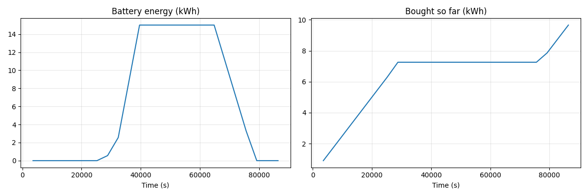

.. _first-simulation-tutorial:

=================================================
Tutorial: Your First Simulation of a Solar Street
=================================================

In about 25 minutes you simulate one sunny day on a small street with rooftop
solar panels (PV) and a shared battery. Every block is ready to copy, and every new idea is explained. 
At the end your script prints:

.. code-block:: text

    Street + 0 kWh battery: bought 28.4 kWh, sold 66.8 kWh, self-sufficiency 25%
    Street + 15 kWh battery: bought 9.7 kWh, sold 48.1 kWh, self-sufficiency 74%
    Street + 30 kWh battery: bought 7.3 kWh, sold 33.1 kWh, self-sufficiency 81%

*Self-sufficiency* is the share of the electricity used that does not come
from the grid: 1 - bought ÷ used. On a cloudy day, or over a whole year, it is
lower. Your script also draws the day with the 15 kWh battery:

          Energy bought rises at night, stays flat from 08:00 to 21:00, then
          rises again until midnight.

    Time is in seconds since midnight. Divide by 3,600 for the hour:
    40,000 s is about 11:00.

You build it from four ideas, the same ones behind every mango simulation:

===============  ======================================  ===========================================  ==========
Idea             Think of it as                          In this tutorial                             Learned in
===============  ======================================  ===========================================  ==========
**Agent**        a device with its own small controller  the houses, the battery, the grid            Part 1
**World, step**  the clock of a time-series simulation   one day = 24 steps of one hour               Part 1
**Message**      a signal on a communication line        a power report sent from agent to agent      Part 2
**Recording**    a data logger                           battery energy and energy bought, each hour  Part 4
===============  ======================================  ===========================================  ==========

.. testsetup:: *

    import os
    import tempfile

    import matplotlib

    matplotlib.use("Agg")

    _tutorial_cwd = os.getcwd()
    _tutorial_tmp = tempfile.TemporaryDirectory()
    os.chdir(_tutorial_tmp.name)

You need Python 3.10 or newer, mango, and the plotting library matplotlib
(other ways to install: :doc:`installation`):

.. code-block:: bash

    pip install mango-agents matplotlib

Write the code into a file ``solar_street.py``. Parts 1 to 4 each tell you what
to add to the file or what to replace. After each part, run
``python solar_street.py`` and compare the output with this page. If something
does not work, see :ref:`first-simulation-troubleshooting`.

.. _first-simulation-house:

Part 1: One house, one day
==========================

The Meyers have solar panels with a peak power of 4 kWp. Their house becomes
your first **agent**. Put the next three blocks into ``solar_street.py``, one
after the other.

.. testcode::

    import asyncio
    from dataclasses import dataclass

    from mango import Agent, on_message, run_with_simulation
    from mango import plot_recordings, record_world

    SUN = [
        0.00, 0.00, 0.00, 0.00, 0.00, 0.00,
        0.00, 0.26, 0.50, 0.71, 0.87, 0.97,
        1.00, 0.97, 0.87, 0.71, 0.50, 0.26,
        0.00, 0.00, 0.00, 0.00, 0.00, 0.00,
    ]
    LOAD_KW = [
        0.3, 0.3, 0.3, 0.3, 0.3, 0.3,
        0.3, 1.0, 1.0, 0.3, 0.3, 0.3,
        0.3, 0.3, 0.3, 0.3, 0.3, 0.3,
        1.3, 1.3, 1.3, 1.3, 0.3, 0.3,
    ]

The ``import`` lines load everything this tutorial needs, including what you
first use in Parts 2 to 4. ``SUN`` and ``LOAD_KW`` are *lists* of 24 hourly
values, six hours per row: the panels' output on an ideal clear day, as a
share of their peak power, and the family's load in kW. You can paste in your
own data later.

.. testcode::

    class House(Agent):
        def __init__(self, pv_peak_kw):
            super().__init__()
            self.pv_peak_kw = pv_peak_kw
            self.pv_kw = 0.0
            self.load_kw = 0.0
            self.load_kwh = 0.0

        def on_step(self, env, clock, step_size_s):
            hour = int(clock.time / 3600) % 24
            self.pv_kw = self.pv_peak_kw * SUN[hour]
            self.load_kw = LOAD_KW[hour]
            self.load_kwh += self.load_kw

- ``class House(Agent):`` defines a *class*, a blueprint; ``(Agent)`` makes
  it a new kind of mango :class:`~mango.Agent`. Each house you create from it,
  like the Meyers' below, is one agent.
- ``__init__`` sets the starting values of a new house. Always keep its first
  line, ``super().__init__()``, which sets up mango's part.
- ``self`` means "this house": ``self.load_kwh`` is its energy use so far.
- ``def on_step(...)`` is what the house does in every step; mango calls it
  for you (:meth:`~mango.Agent.on_step`). Of the values mango passes in, you
  only need ``clock``, the world's clock (:ref:`how it moves
  <simulation-fixed-step>`). For an agent that acts on its own timetable
  instead, say every 4 hours, see :func:`~mango.periodic` in
  :doc:`scheduling`.
- ``int(clock.time / 3600) % 24`` turns the clock's time into the hour of the
  day, 0 to 23. The time is in seconds and starts at 0, which this tutorial
  takes as midnight. ``int()`` drops the decimals, and ``% 24`` keeps the
  remainder after dividing by 24, so a second day starts again at hour 0.
  ``SUN[hour]`` picks that hour's value from the list, counting from 0.
- ``+=`` adds to a running total. A step lasts one hour, so x kW for one step
  is x kWh. The grid and the battery below rely on this too, so keep steps at
  one hour.

.. testcode::

    async def main():
        meyer = House(pv_peak_kw=4.0)
        async with run_with_simulation(meyer) as world:
            for hour in range(24):
                await world.step(step_size_s=3600)
                if hour % 3 == 0:
                    print(
                        f"{hour:02}:00  PV {meyer.pv_kw:.1f} kW,",
                        f"load {meyer.load_kw:.1f} kW",
                    )
        print(f"Used today: {meyer.load_kwh:.1f} kWh")

    asyncio.run(main())

.. note::

    **Copy as is.** ``async``, ``await`` and ``asyncio.run(main())`` let mango
    run many agents at once. The one rule: ``await`` goes in front of
    ``world.step``, and the ``def`` lines inside your agents need no ``async``.

- ``async def main():`` is the recipe for one run: create the agents, then
  step through the day. Nothing in it runs until the last line,
  ``asyncio.run(main())``, starts it.
- ``House(pv_peak_kw=4.0)`` creates the Meyers' house; the value in brackets
  goes to ``__init__``.
- :func:`~mango.run_with_simulation` starts a simulation **world** with the
  agents you list; ``as world`` gives it the name ``world``, and the indented
  lines below run inside it (:ref:`more about worlds <simulation-express>`).
  Outside a simulation, agents run in real time inside *containers*:
  :doc:`agents-container`.
- ``await world.step(step_size_s=3600)`` moves the clock on by one **step** of
  3,600 s. A world can also jump from event to event:
  :ref:`simulation-discrete-event`.
- ``for hour in range(24):`` repeats the indented lines for hours 0 to 23, and
  ``if hour % 3 == 0:`` runs its lines only every third hour.
- ``f"..."`` fills values into text: ``:.1f`` shows one decimal, ``:02`` two
  digits. ``print()`` writes its parts on one line, with a space between.

Save the file and run ``python solar_street.py``. You should see:

.. testoutput::

    00:00  PV 0.0 kW, load 0.3 kW
    03:00  PV 0.0 kW, load 0.3 kW
    06:00  PV 0.0 kW, load 0.3 kW
    09:00  PV 2.8 kW, load 0.3 kW
    12:00  PV 4.0 kW, load 0.3 kW
    15:00  PV 2.8 kW, load 0.3 kW
    18:00  PV 0.0 kW, load 1.3 kW
    21:00  PV 0.0 kW, load 1.3 kW
    Used today: 12.6 kWh

On this sunny day the panels make 30.5 kWh (the ``SUN`` values add up to 7.62,
times 4 kWp), more than twice what the Meyers use. But the sun peaks at noon,
and the family uses the most in the evening.

.. _first-simulation-messages:

Part 2: The house reports to the grid
=====================================

How much electricity do the Meyers still buy? A second agent, the grid, keeps
count: every hour, the house sends it a **message**. Replace everything from
``class House`` to the end of the file with the next three blocks.

.. testcode::

    @dataclass
    class PowerReport:
        net_kw: float

    class House(Agent):
        def __init__(self, pv_peak_kw, connected_to):
            super().__init__()
            self.pv_peak_kw = pv_peak_kw
            self.connected_to = connected_to
            self.pv_kw = 0.0
            self.load_kw = 0.0
            self.load_kwh = 0.0

        def on_step(self, env, clock, step_size_s):
            hour = int(clock.time / 3600) % 24
            self.pv_kw = self.pv_peak_kw * SUN[hour]
            self.load_kw = LOAD_KW[hour]
            self.load_kwh += self.load_kw
            report = PowerReport(net_kw=self.pv_kw - self.load_kw)
            self.schedule_instant_message(report, self.connected_to.addr)

- ``PowerReport`` is the message. It has no ``(Agent)``, so it is not an
  agent but a simple form with one number, ``net_kw``: the PV minus the load
  in kW (``float`` means a number with decimals). It is positive when the
  house has spare power and negative when it is short.
- ``@dataclass`` is a *decorator*: a label above a definition that adds
  ready-made behaviour. Here it lets you fill in a report with
  ``PowerReport(net_kw=...)``. In a simulation any Python object can be a
  message; only a real network needs :doc:`extra setup <codecs>`.
- New in ``House``: ``connected_to``, the agent it reports to, and the last
  two lines. They create a report and send it to that agent's address,
  :attr:`~mango.Agent.addr`, with
  :meth:`~mango.Agent.schedule_instant_message`. Every agent gets an address
  from mango, like a phone number, and messages always go to an address (more
  ways to send: :doc:`message exchange`).

.. testcode::

    class Grid(Agent):
        def __init__(self):
            super().__init__()
            self.bought_kwh = 0.0
            self.sold_kwh = 0.0

        @on_message(PowerReport)
        def handle_report(self, report, meta):
            if report.net_kw > 0:
                self.sold_kwh += report.net_kw
            else:
                self.bought_kwh += abs(report.net_kw)

- ``@on_message(PowerReport)`` is another decorator: it tells mango to call
  ``handle_report``, the *handler*, whenever a ``PowerReport`` arrives
  (:func:`~mango.on_message`). To filter messages or set priorities, see
  :ref:`agent-handlers`.
- ``report`` is the message; ``meta`` holds delivery details you do not need.
- ``if`` ... ``else`` books each hour's spare energy as sold (fed into the
  grid) and missing energy as bought (taken from the grid). ``abs()`` drops
  the minus sign.

.. testcode::

    def show_result(label, grid, load_kwh):
        self_sufficiency = 1 - grid.bought_kwh / load_kwh
        print(
            f"{label}: bought {grid.bought_kwh:.1f} kWh,",
            f"sold {grid.sold_kwh:.1f} kWh,",
            f"self-sufficiency {self_sufficiency:.0%}",
        )

    async def main():
        grid = Grid()
        meyer = House(pv_peak_kw=4.0, connected_to=grid)
        async with run_with_simulation(meyer, grid) as world:
            for hour in range(24):
                await world.step(step_size_s=3600)
        show_result("Meyer house", grid, meyer.load_kwh)

    asyncio.run(main())

- ``def show_result(label, grid, load_kwh):`` is a second recipe of your own.
  The call at the end of ``main`` hands it three values in this order: a
  label, the grid and the energy used. It prints the totals and the
  self-sufficiency, 1 - bought ÷ used; ``:.0%`` shows a percentage.
- Both agents are listed in ``run_with_simulation``: an agent that is not
  listed cannot receive messages.

Save and run the script. You should see:

.. testoutput::

    Meyer house: bought 7.9 kWh, sold 25.8 kWh, self-sufficiency 37%

Check: 7 h × 0.3 kW at night, 4 h × 1.3 kW in the evening and 2 h × 0.3 kW
before midnight make 7.9 kWh. The sun barely covers the morning peak: 1.04 kW
of PV against 1.0 kW of load at 07:00.

**One step, three moves.** In every ``world.step``, mango

#. calls ``on_step`` of every agent, in the order you listed them;
#. delivers every message of this hour, including those sent by handlers;
#. saves the recordings, stamped with the end of the hour (you add recordings
   in Part 4).

Messages arrive instantly here. To simulate delays or lost messages, see
:ref:`simulation-communication`.

.. _first-simulation-battery:

Part 3: A battery in the basement
=================================

Does a 5 kWh battery help? It becomes a third agent between house and grid.
It has no losses and no power limit, and it starts empty. Replace everything
from ``async def main`` to the end of the file with the next two blocks.

.. testcode::

    class Battery(Agent):
        def __init__(self, capacity_kwh, connected_to):
            super().__init__()
            self.capacity_kwh = capacity_kwh
            self.connected_to = connected_to
            self.stored_kwh = 0.0

        @on_message(PowerReport)
        def handle_report(self, report, meta):
            if report.net_kw > 0:
                free_kwh = self.capacity_kwh - self.stored_kwh
                charge_kw = min(report.net_kw, free_kwh)
            else:
                charge_kw = max(report.net_kw, -self.stored_kwh)
            self.stored_kwh += charge_kw
            rest = PowerReport(net_kw=report.net_kw - charge_kw)
            self.schedule_instant_message(rest, self.connected_to.addr)

- ``min()`` gives the smaller value, ``max()`` the larger: the battery charges
  at most its free space and discharges (a negative charge) at most what it
  holds. As in Part 1, x kW for one hour is x kWh.
- The battery sends the ``rest`` on to the agent it is connected to. It does
  not answer the house; for agents that answer, see
  :ref:`answering a message <message-exchange-reply-to>`.

.. testcode::

    async def main():
        grid = Grid()
        battery = Battery(capacity_kwh=5.0, connected_to=grid)
        meyer = House(pv_peak_kw=4.0, connected_to=battery)
        async with run_with_simulation(meyer, battery, grid) as world:
            for hour in range(24):
                await world.step(step_size_s=3600)
        show_result("Meyer house + 5 kWh battery", grid, meyer.load_kwh)

    asyncio.run(main())

The house now reports to the battery, and the battery to the grid. ``House``
and ``Grid`` did not change: you only connected them differently. Save and
run the script. You should see:

.. testoutput::

    Meyer house + 5 kWh battery: bought 2.9 kWh, sold 20.8 kWh, self-sufficiency 77%

The battery is full by 11:00 and empty at 22:00: it moves 5.0 kWh of morning
sun into the evening, so the Meyers buy 7.9 - 5.0 = 2.9 kWh.

.. note::

    **Agents and roles.** Here each agent does one job, written directly in
    its class. When one agent has several jobs, say a house that also steers
    its own battery and trades on a local market, you can build it from
    smaller, reusable parts called *roles*. Each role is a
    :class:`~mango.Role`, and :func:`~mango.agent_composed_of` combines them
    into one agent. Roles use the same decorators, such as ``@on_message``.
    You do not need them for this tutorial; when your agents grow, see
    :doc:`the roles guide <role-api>`.

.. _first-simulation-street:

Part 4: The neighbours join
===========================

The Novaks (no panels) and the Okafors (6 kWp) join. All three houses report
to one shared battery, which you try in three sizes:

.. code-block:: text

    Meyer house  (4 kWp) --+
    Novak house  (no PV) --+--> shared battery --> grid
    Okafor house (6 kWp) --+

The day is now too busy to follow by hand, so you **record** it. Replace
everything from ``async def main`` to the end of the file with this block.

.. testcode::

    async def main(battery_kwh):
        grid = Grid()
        battery = Battery(capacity_kwh=battery_kwh, connected_to=grid)
        meyer = House(pv_peak_kw=4.0, connected_to=battery)
        novak = House(pv_peak_kw=0.0, connected_to=battery)
        okafor = House(pv_peak_kw=6.0, connected_to=battery)
        async with run_with_simulation(meyer, novak, okafor, battery, grid) as world:
            record_world(world, "Battery energy (kWh)", lambda: battery.stored_kwh)
            record_world(world, "Bought so far (kWh)", lambda: grid.bought_kwh)
            for hour in range(24):
                await world.step(step_size_s=3600)
        street_load_kwh = meyer.load_kwh + novak.load_kwh + okafor.load_kwh
        show_result(f"Street + {battery_kwh} kWh battery", grid, street_load_kwh)
        plot_recordings(world, write_to=f"street_{battery_kwh}kWh.png")

    asyncio.run(main(battery_kwh=0))
    asyncio.run(main(battery_kwh=15))
    asyncio.run(main(battery_kwh=30))

- ``main(battery_kwh)`` takes the battery size in kWh, so the last three lines
  run the same day three times: with no battery (0 kWh), with 15 kWh and with
  30 kWh.
- Three houses, one class: you add agents, not classes. To connect hundreds of
  agents, see :doc:`topology`.
- :func:`~mango.record_world` keeps a **recording**: one value after every
  step, under a name with its unit. ``lambda:`` turns ``battery.stored_kwh``
  into a one-line recipe, so mango reads the current value each time. To
  record one value per agent, see :ref:`simulation-recording`.
- :func:`~mango.plot_recordings` draws all recordings into a picture file.
  For other charts, see :ref:`simulation-visualization`.

Before you run it, guess: does the 30 kWh battery add as much as the first
15 kWh? Save and run the script. You should see:

.. testoutput::

    Street + 0 kWh battery: bought 28.4 kWh, sold 66.8 kWh, self-sufficiency 25%
    Street + 15 kWh battery: bought 9.7 kWh, sold 48.1 kWh, self-sufficiency 74%
    Street + 30 kWh battery: bought 7.3 kWh, sold 33.1 kWh, self-sufficiency 81%

Your folder now holds ``street_0kWh.png``, ``street_15kWh.png`` (the figure at
the top) and ``street_30kWh.png``; open them like any picture. Each point is
the value at the end of an hour, so the lines start at 3,600 s (01:00).

Without a battery the street buys 7.9 + 12.6 + 7.9 = 28.4 kWh. The Meyers and
the Okafors buy 7.9 kWh each, at night and in the evening. The Novaks buy all
12.6 kWh they use, even while the Okafors sell at noon, because each house has
its own meter. With 15 kWh, the shared battery carries the noon surplus into
the evening, for the Novaks too.

And your guess? No: the first 15 kWh cut the energy bought by 18.7 kWh
(28.4 - 9.7), the next 15 kWh by only 2.4 kWh (9.7 - 7.3). Both batteries are
full at 18:00, and from then to midnight the street uses 17.4 kWh. The 15 kWh
battery covers 15 kWh of that, so the street buys the other 2.4 kWh. The
30 kWh battery covers all of it and still holds 30 - 17.4 = 12.6 kWh at
midnight (see ``street_30kWh.png``). With 30 kWh, the street buys 7.3 kWh, all
before the battery has charged: 6.3 kWh before sunrise (3 houses × 0.3 kW ×
7 h) and about 1 kWh for the Novaks' breakfast at 07:00. On a second sunny day
the leftover would cover that night, so a one-day run undervalues a big
battery.

In each hour, the battery handles the three reports one by one, in the order
you listed the houses, while a real battery would see their sum. Another order
shifts the results by one or two percentage points.

.. tip::

    **Try it yourself.** Swap the shared 15 kWh battery for three private
    5 kWh ones. In ``main``, create three ``Battery`` agents, each with its
    own name such as ``battery_meyer`` and each connected to the grid, and
    connect each house to its own. List all three in ``run_with_simulation``,
    and change ``battery`` in the first ``record_world`` line to one of them.
    Replace the three run lines with ``asyncio.run(main(battery_kwh=5))``.
    Expect 51% instead of 74%: the Meyers and Okafors buy 2.9 kWh each, as in
    Part 3, but the Novaks' battery never charges.

.. _first-simulation-troubleshooting:

If something goes wrong
=======================

When Python stops with an error, it prints a long report. Read its last line
first: it names the problem. The last line that mentions ``solar_street.py``
shows where in your file.

``ModuleNotFoundError: No module named 'mango'`` or ``ImportError``
    mango or matplotlib is missing, or mango is older than 2.3. Run
    ``pip install --upgrade mango-agents matplotlib``.
``IndentationError`` or ``TabError``
    Python reads the spaces at the start of a line. Copy blocks exactly, and
    indent lines you type yourself with 4 spaces per level, not the Tab key.
``SyntaxError``
    Two lines got stuck together, such as ``]class House(Agent):``. Put a line
    break between them, and leave an empty line between blocks.
``RuntimeWarning: coroutine ... was never awaited``, often with ``ZeroDivisionError``
    Write ``await`` in front of ``world.step``, and remove ``async`` in front
    of ``def on_step``.
``AttributeError: 'NoneType' object has no attribute 'aid'``
    An agent you connected to is missing from ``run_with_simulation(...)``.
    The script may keep running, but its numbers are wrong.
The script freezes after ``The check inbox task of agent... failed!``
    A message handler has an error, shown below that line. Stop the script
    with :kbd:`Ctrl+C`, fix the error, and run it again.
Nothing is printed
    The file is not saved yet, or its last line, ``asyncio.run(...)``, is
    missing.
The numbers differ from this page
    Save the file first. Then compare it with the blocks above. After Part 4
    it holds, from top to bottom and each only once: the imports, ``SUN``
    and ``LOAD_KW``; ``PowerReport``; ``House`` as in Part 2; ``Grid``;
    ``show_result``; ``Battery``; ``main`` as in Part 4; and the three
    ``asyncio.run`` lines.

To follow every step and message of a run on a timeline, see
:doc:`the tracing guide <tracing>`.

.. _first-simulation-next:

Where to go next
================

The simulation guide and the EV tutorial write
``await world.step(step_size_s=3600)`` as
``await step_simulation(world, step_size_s=3600)``; both do the same.

- :doc:`advanced-simulation-tutorial`: continue here. The same street
  becomes a simulation study with an environment, electric cars on their own
  timetables, a coordinator that asks before it shares the cable, and a slow
  wallbox.
- :doc:`simulation-ev-tutorial`: electric cars that drive across a
  neighbourhood map and carry solar energy between houses.
- :doc:`simulation`: everything the simulation world can do.
- :doc:`tutorial`: agents in real time, talking over a real network.
- :doc:`features`: all mango features, sorted by what you want to do.

.. testcleanup:: *

    os.chdir(_tutorial_cwd)
    _tutorial_tmp.cleanup()
